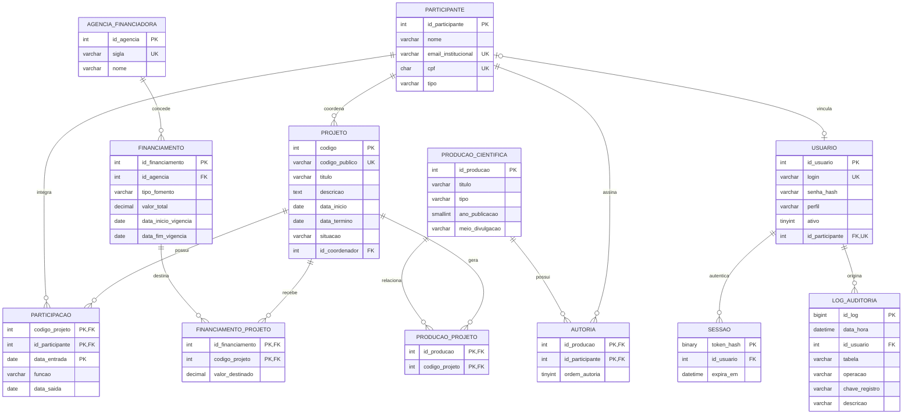

# Modelo lógico do SIGPesq

Diagrama em pé de galinha das 12 tabelas após a carga e as migrações 001 e 002. As relações mostram a cardinalidade garantida pelas chaves estrangeiras. Veja as regras adicionais abaixo e os tipos no [dicionário resumido](RELATORIO-ACADEMICO.md#5-modelagem-lógica-e-dicionário-resumido).

- `PROJETO.id_coordenador` referencia obrigatoriamente um participante do tipo docente. O cadastro de projeto cria o vínculo de coordenação; a troca preserva o período anterior.
- A associação de `USUARIO` com `PARTICIPANTE` é opcional na estrutura física. Os gatilhos e a sessão exigem o vínculo conforme o perfil.
- As FKs permitem que uma produção exista fisicamente com zero vínculos dependentes. A API exige no mínimo um autor e um projeto e grava as associações em transação. A ordem é única por produção.
- Cada associação de financiamento registra valor destinado. A soma das destinações está limitada ao valor total.
- O MER conceitual acadêmico permanece na entrega original do modelo de dados. Este diagrama descreve a versão relacional efetivamente instalada.
